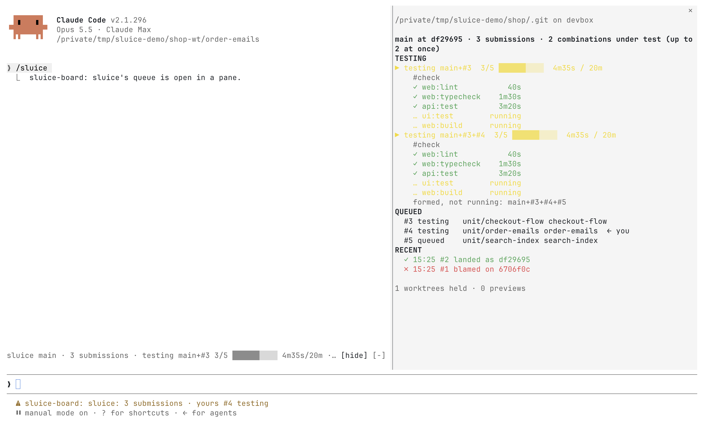

<div align="center">

<picture>
  <source media="(prefers-color-scheme: dark)" srcset="docs/brand/sluice-mark-dark.svg">
  
</picture>

# sluice

**A merge queue for agents working in parallel worktrees.**

Agents submit. sluice tests each submission exactly as it would land,<br>
names the one that broke the build, and moves the branch only to code that passed.

[](https://github.com/agentplot/sluice/actions/workflows/ci.yml)
[](https://github.com/agentplot/sluice/releases/latest)
[](LICENSE)

</div>

<a href="plugins/sluice-board/">
<picture>
  <source media="(prefers-color-scheme: dark)" srcset="plugins/sluice-board/screenshots/board-dark.png">
  
</picture>
</a>

## Get started

**With Claude Code.** At the prompt of a Claude Code session in a terminal:

```
/plugin marketplace add agentplot/sluice
/plugin install sluice@sluice
```

Then ask Claude to set sluice up in your repository. It installs the
`sluice` binary if it is missing, asking first, writes
`.config/sluice.toml` for the tools you already use, and lands its own work
through the queue from then on. [The Claude Code
plugin](https://agentplot.github.io/sluice/guides/claude-code/) says what it
does.

**With herdr.** [The herdr
plugin](https://agentplot.github.io/sluice/guides/herdr/) shows the queue
beside your agents' panes. It is not released yet.

**By hand.** [Install](#install) the binary and follow the
[walkthrough](https://agentplot.github.io/sluice/guides/walkthrough/).

## Why

<p align="center">
  
</p>

Run ten coding agents in ten worktrees and each one's tests pass on its
own. Merge them and the branch breaks, because nobody tested the
combination. Let the agents merge for themselves and they race, rebase
over each other's work, and can't tell whose change broke the build.

sluice takes merging away from the agents. Each one finishes its work and
**submits** it. sluice queues the submissions, tests each one **on top of
everything queued ahead of it**, and lands it only if that exact
combination passes.

- **Tested as it lands.** A candidate is the branch, plus every
  submission ahead, plus this one, checked out fresh in its own worktree.
  The commit that lands carries exactly the tree that passed.
- **One culprit, one message.** When a combination fails, sluice works
  out the one submission at fault and tells only that agent, with the
  failing tasks and their logs. Everyone else's work keeps moving.
- **The branch only moves to green.** A git hook refuses every update to
  a protected branch except sluice's, and sluice moves it only from the
  revision it tested on.
- **Parallel, and frugal.** Several candidates are tested at once, each
  starting from the build cache its policy declares. With
  [moon](https://moonrepo.dev), only the tasks a change affects run, and
  a branch can accept results moon already has.
- **Confined checks.** A run can be held in a sandbox: it writes only its
  own worktree and reaches only the network its branch allows.
- **Agents' own test runs, under the same bound.** `sluice exec` runs an
  agent's tests in its worktree with ports of its own and the branch's
  limits, sharing the host with the queue's runs; a clean run is recorded
  for the submission that follows.
- **Try what landed.** `sluice preview` brings a revision a branch landed
  up on the repository's own stack, at addresses a person opens, and
  keeps it until it is released: one per landing, with nothing kept
  checked out by hand. It is a cheap environment on the tests' own fakes,
  not a deployment ([previews](https://agentplot.github.io/sluice/guides/previews/)).
- **No daemon.** sluice keeps nothing running itself. A waiting `sluice
  submit` drives the queue while it waits; `sluice run`, or `sluice
  step` from cron, does the same for a host. What a preview leaves up,
  the repository's own tools keep until its release. Every decision is
  written to plain files before it is acted on, so a crash at any point
  resumes cleanly.

## Install

```sh
nix profile install github:agentplot/sluice
```

<details>
<summary>Other ways: a release binary, cargo, a flake input</summary>

**A release binary**, for macOS on Apple silicon and Linux on x86-64 and
ARM:

```sh
curl -fsSL https://github.com/agentplot/sluice/releases/latest/download/sluice-aarch64-darwin.tar.gz \
  | tar -xz -C ~/.local/bin sluice wt-submit
```

Linux: `sluice-x86_64-linux.tar.gz` or `sluice-aarch64-linux.tar.gz`.

**With cargo** (Rust 1.98 or later):

```sh
cargo install --locked --git https://github.com/agentplot/sluice sluice
```

**As a flake input**, for NixOS, home-manager or a devenv shell:

```nix
inputs.sluice.url = "github:agentplot/sluice";
# then: inputs.sluice.packages.${system}.default
```

</details>

Each installs two executables: `sluice`, and `wt-submit`, which
[worktrunk](https://github.com/max-sixty/worktrunk) runs as `wt submit`.

## Quick start

**1. Say what gates the branch.** Commit `.config/sluice.toml`:

```toml
[tests]
runner = "command"          # or "moon", to run only what a change affects
command = "make test"

[branches.main]
parallel = 4                # combinations under test at once
batch = false               # true for a slow suite: test only the longest
```

sluice reads this file from the branch itself, never from a submission,
so no submission can loosen the rules it is judged by.

Leave `batch = false` when the tests take a few minutes: each submission
is tested as soon as it arrives, on the bet that those ahead pass. Set
`batch = true` when they take a quarter of an hour or more: sluice tests
one combination of everything queued, lands all of it when that
passes, and looks for the submission to blame only on a failure. A
branch with `batch = true` tests one run at a time.

<p align="center">
  
</p>

[Parallel and batch](https://agentplot.github.io/sluice/guides/parallel-and-batch/)
shows a failure in each, why a queue tests fewer at once after
failures, and how the host's `[runs] max` caps them all.

**2. Protect the branch**, once per repository:

```sh
sluice protect
```

**3. Submit** from an agent's worktree, with its work committed:

```sh
sluice submit main          # or: wt submit main
```

It waits, and says what happened:

```
submission 3 to main · 1 queued ahead (#2)
testing main + #2 + #3 · 4 tasks to run, 2 replayed
passed · landed as 9f2c1e4
```

or, when this submission broke the combination:

```
failed: tests:t-cards
  on main + #2 + #3 (5b81d07)
  #2 passed on its own, so the failure is from this submission
  log of tests:t-cards: /…/sluice/.logs/main/c4/tests:t-cards.log
fix it in your worktree and submit again
```

The exit code says the same: `0` landed, `1` failed, `2` a conflict or a
refusal, `130` stopped with Ctrl-C (the submission stays queued). Any
command exits `3` when sluice itself fails and `64` on a command line it
cannot read.

A complete setup, with moon, a sandbox, a build cache and two tiers of
branches, is walked through in [docs/examples](docs/examples/README.md).

**4. On many hosts**, when agents on several machines submit to one
branch, or a check must pass on Linux and macOS: name signers in the
policy, and the branch's queue moves to its git remote, shared by every
host, with no server. Each host signs the results it runs; a box you keep
running with `sluice run` takes the checks first, and an agent can submit
and switch its machine off. [Executors and
systems](https://agentplot.github.io/sluice/guides/executors-and-systems/)
sets it up.

## Commands

| Command | |
|---|---|
| `sluice submit <branch>` | Queue this worktree's head and wait for the outcome. `--no-wait` returns once queued; `--status` reports where this worktree's last submission stands; `--check` only reports whether it would conflict; `--after 2,5` lands it after those; `--json` for scripts. |
| `sluice wait <id>` | Wait for a submission's outcome, running the rounds as a waiting submit does; `--timeout 9m` returns after that long, exiting `5`, for an agent whose tool calls are capped; `--json` prints its record. |
| `sluice status <branch>` | The queue: each submission still in it, its agent, its worktree and its state, and how far each combination under test has got; `--all` for every one the branch has had. `sluice status <id>` for one; `sluice status` alone lists the worktrees sluice holds. |
| `sluice` | Where this worktree stands: its submission, each branch's queue, its place and what to run next. `--json` for a status line. |
| `sluice overview` | Every branch's queue at a glance, with the latest landings and blames. `--json` for tools; `--json --watch` prints it again on each change. |
| `sluice run` | Work every branch's queue until stopped. |
| `sluice step <branch>` | One round of a branch's work, then exit: for cron, CI or a hook. `--json` for scripts. |
| `sluice amend <id>` | Reorder a queued submission (`--after`, `--priority`) until it is under test. `--json` for scripts. |
| `sluice withdraw <id>` | Take a submission out of the queue; one already withdrawn exits `0` and says so. `--json` for scripts. |
| `sluice protect` | Install the branch-protection hook; `--remove` takes it out. Warns of a worktree that has checked out a protected branch. `--json` for scripts. |
| `sluice exec <branch>` | Run the tests this worktree's head affects against the branch, in the worktree, under the host's bound; `-- <command>` runs a command instead. |
| `sluice release` | Release this worktree: its release command, what its runs left running, its ports. `--json` for scripts. |
| `sluice preview <branch> <revision>` | Bring up a revision the branch has landed, at the addresses the policy's `[preview]` names, until it is released. `--wait`, `--json`. |
| `sluice previews` | Every preview on the host, with its addresses and state. |
| `sluice release <preview>` | Release a preview, by its name or its revision. `--json` for scripts. |
| `sluice branch create <branch> --from <branch>` | Make a branch sluice lands on, such as a bolt, on its remote when its policy names one; `sluice branch delete <branch>` deletes it once it has landed into `main`. |

An agent names itself with `SLUICE_AGENT`. How many runs a host tests at
once is the host's own setting, in `~/.config/sluice/config.toml`:

```toml
[runs]
max = 2    # default: a quarter of the cores, shared equally between runs
```

## Telemetry

With `SLUICE_OTEL=1`, sluice sends traces and metrics over OTLP to
`localhost:4318`: a trace per round, with each candidate's forming,
testing, verdict and landing, and metrics for queue depth, time to land,
failures and cache use. moon's traces from inside each run carry the
round's trace id. Nothing reads them back: the queue never depends on
its telemetry.

```sh
nix run nixpkgs#otel-tui    # watch it in a terminal
```

Setting up a host to receive it: [docs/telemetry.md](docs/telemetry.md).

## Platforms

| | macOS | Linux |
|---|---|---|
| The queue, worktrees, checks, branch protection | ✓ | ✓ |
| Release binaries | Apple silicon | x86-64, ARM |
| Sandboxed checks | ✓ Seatbelt | planned: bubblewrap, Landlock |

Several hosts, macOS and Linux among them, share one branch's queue as
peers through its git remote, with no server: see *On many hosts* under
[Quick start](#quick-start).

## How it is built

A small core that knows git, and five seams it reaches everything else
through: where a candidate is checked out, how its checks run, how the
branch moves, how agents submit, and where the records live. Each seam
is bound by a profile, so one core works with moon or a plain command, a
sandbox or none, local refs or a forge.

The design is a statement of invariants in
[agentplot/blueprints](https://github.com/agentplot/blueprints)
(`design/sluice/requirements.md`). This repository cites its clauses by
number, keeps the rules a change must respect in
[docs/architecture](docs/architecture/core.md), and records each decision
in [docs/adr](docs/adr).

sluice lands its own changes: `main` here moves only through sluice,
gated on every test tier in a sandbox.

## Development

Developer documentation: https://agentplot.github.io/sluice (source in
`site/`, published by `.github/workflows/pages.yml`).

```sh
devenv shell
moon run ':#check-fast' ':#check-tools' ':#check-e2e'
```

Commits follow [Conventional Commits](https://www.conventionalcommits.org),
checked by a commit hook. Each push to `main` with a feature, a fix or a
docs change is tagged and released, with notes by
[git-cliff](https://git-cliff.org); `release-preview` shows the next one.

## License

[MIT](LICENSE)
