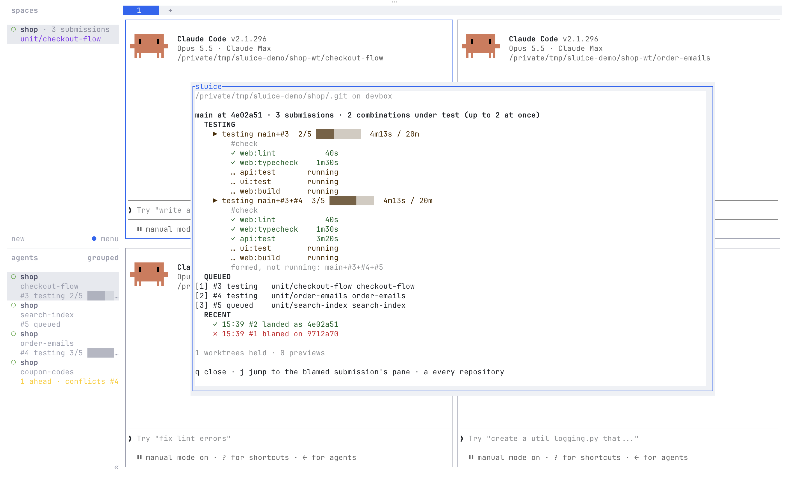

# sluice for herdr

sluice's merge queue beside your agents in [herdr](https://herdr.dev).

<picture>
  <source media="(prefers-color-scheme: dark)" srcset="screenshots/popup-dark.png">
  
</picture>

```sh
herdr plugin install agentplot/sluice/plugins/herdr
```

Needs herdr 0.9.3 or later, `sluice` 0.12 or later and `jq` on `PATH`, on
Linux or macOS. It reads everything from `sluice overview --watch --json`
in each repository with sluice's records that one of your panes is in, and
does nothing elsewhere. It never submits, withdraws or lands anything.

## What you get

- **The status popup**, on the key you bind to `agentplot.sluice.status`:
  for the focused pane's repository, each branch's combinations under test
  with their tests and time, the submissions queued, and recent landings,
  blames and conflicts, under TESTING, QUEUED and RECENT, in the same words
  as the Claude Code board's `/sluice` pane. It redraws as the queue moves.
  A branch with nothing queued is left out, and counted on one line, once
  a quarter hour has passed since its last landing, blame or conflict.
  `q` or Escape closes it, `j` jumps to the blamed submission's pane, `a`
  shows every repository the plugin holds, and the arrow keys and Page Up
  and Down scroll it when it is taller than the popup.
- **The dashboard**: the same view in its own tab, every repository at
  once (`agentplot.sluice.dashboard`).
- **Rows that act**: in the popup and the dashboard, Ctrl-click a
  submission to go to its agent's pane, or a failed test's `log of` row to
  open the log in a split. In the popup those rows are also numbered `[1]`
  to `[9]`: press the number. A link only acts on a worktree or a log the
  queue names, so a link printed by anything else does nothing.
- **Toasts**: one when a submission is blamed or conflicts, always; one
  when a submission lands, only when its agent's pane is open and not the
  one you are looking at.
- **Jump** (`agentplot.sluice.jump`): focus the pane whose worktree made
  the submission most recently blamed or in conflict. herdr's toasts take
  no click, so this is how a toast takes you to the pane.
- **A line on each agent's sidebar entry**, the `$sluice` token. herdr's
  Agents list shows only panes where it sees an agent running, so a plain
  shell's pane gets the token but no line:

  | The worktree | The line |
  |---|---|
  | has a submission queued or under test | `#95 testing 3m/15m` |
  | had its latest submission blamed, or in conflict | `#87 BLAMED · tests:t-cards`, `#53 CONFLICT · a.rs` |
  | is ahead of its branch | `3 ahead · clean`, `3 ahead · conflicts #95` |
  | landed in the last 30 minutes | `#94 landed 12m` |
  | none of these | no line |

  The ahead line forecasts with `sluice submit <branch> --check --json`,
  run again only when the worktree's head or the branch moves. On a branch
  with a `remote`, a forecast fetches the branch; set `ahead_check = false`
  (below) to show the count alone.
- **The queue on each workspace's row**, the `$sluice_q` token
  (`4 submissions`, every branch counted).
- **The tab bar**: the focused repository's queue on one line, as the
  board's band says it: `sluice main · 3 submissions · testing
  main+#12+#13 2m10s/15m · #14 waiting · last #9 blamed on 4f1c2aa`.

Every token is set again at least every 15 seconds and expires after two
minutes, so nothing stale stays if the plugin stops.

## Setting it up

The plugin changes none of herdr's config. Run the `setup` action
(`herdr plugin action invoke agentplot.sluice.setup`) to see the snippets
with this machine's paths filled in, and add them to herdr's `config.toml`
yourself, or to whatever generates it:

```toml
[[keys.command]]
key = "prefix+s"
type = "plugin_action"
command = "agentplot.sluice.status"
description = "sluice: the queue"

[[keys.command]]
key = "prefix+shift+s"
type = "plugin_action"
command = "agentplot.sluice.jump"
description = "sluice: jump to the blamed submission's pane"

[ui.sidebar.agents]
rows = [
  ["state_icon", "machine", "workspace", "tab"],
  ["agent"],
  [{ token = "$sluice", rules = [{ contains = "BLAMED", fg = "#f55", bold = true }, { contains = "CONFLICT", fg = "#f55", bold = true }, { contains = "conflicts", fg = "#fc0" }] }],
]

[ui.sidebar.spaces]
rows = [
  ["state_icon", "workspace", "$sluice_q"],
  ["branch", "git_status"],
]

[ui]
tab_bar_right = [
  { type = "command", command = "sh '<state directory>/segment/bin/segment.sh'", interval_seconds = 5, timeout_seconds = 2 },
]

[ui.toast]
delivery = "herdr"
```

The sidebar rows above are herdr's own plus one; if you have rows of your
own, add only the `$sluice` row. Toasts need `[ui.toast]` delivery on. The
tab-bar command runs a copy the plugin keeps in its state directory, so it
survives a reinstall; `setup` prints its path.

## Sources

By default the plugin runs `sluice overview --watch --json` in every
repository with sluice's records that a pane is in. To read documents from
anywhere else, list the commands in `sources.toml`, in the plugin's config
directory (`herdr plugin config-dir agentplot.sluice`):

```toml
# Show the ahead count without forecasting.
ahead_check = false

# The default, kept: run in every repository a pane is in.
[[sources]]
name = "local"
command = ["sluice", "overview", "--watch", "--json"]
each_repository = true

# Any command printing sluice/overview@1 documents, one per line; run once.
[[sources]]
name = "build machine"
command = ["my-overview-stream", "app"]
```

Each document is shown under its own `host` and `repository`; a repository
of the same name read from two hosts shows as two blocks. A pane is tied to
a submission by the worktree the submission came from, on this machine.

The file is read as a small part of TOML: `[[sources]]` tables, `key =
"string"`, arrays of strings on one line, `true` and `false`, and `#`
comments. Anything else is reported in the plugin's log with its line
number, and the default source is used.

## Tests

`plugins/herdr/tests/run.sh` runs every script against stand-in `herdr`
and `sluice` on scratch repositories; the repository's gate runs it as the
moon project `plugin-herdr`: `test-sh` under the system's sh, `test-dash`
under dash where it is installed, and `manifest`, `tests/manifest.sh`.
