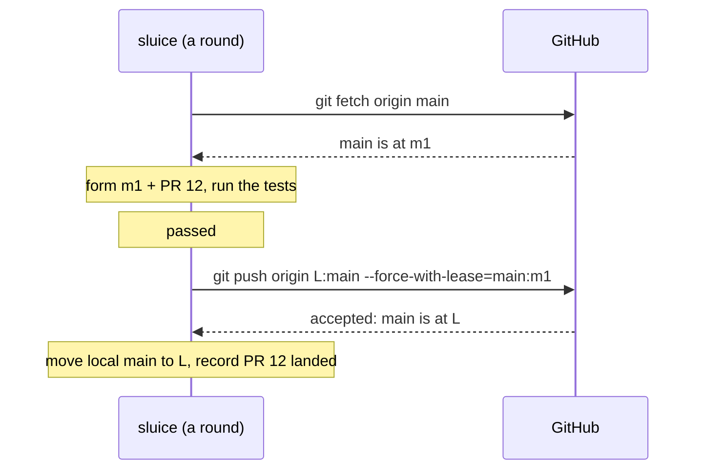

:::caution[Designed, not built]
This is the design of piece 23 of sluice's plan, under review in
[agentplot/blueprints](https://github.com/agentplot/blueprints),
`design/sluice/proposals/pull-requests-1.md`. The commands below show
what it will look like.
:::

[Setting up sluice](/sluice/guides/walkthrough/) lands on a branch in
the repository on your machine. Most teams' `main` lives on GitHub
instead, and everyone pulls it from there. This guide makes sluice land
on GitHub's `main`, still running everything on your one machine.

## What changes

One line in the branch's policy, `.config/sluice.toml`:

```toml
[branches.main]
remote = "origin"
required = ["#check-fast", "#check-tools"]
```

With `remote` set, GitHub's copy of `main` is the real one:

- **Every round fetches it first.** Whoever runs the round (a waiting
  `wt submit`, `sluice run` or `sluice step`) runs `git fetch origin
  main` before reading the branch, and forms every combination on
  `origin/main`.
- **A landing is a push.** When a combination passes, sluice pushes its
  merge commit to GitHub's `main`, and the push only succeeds if `main`
  is still where the combination started. Then it moves your local
  `main` to match.
- **Only the branch goes to GitHub.** The queue, the test results and
  the logs stay in `.git/sluice/` on your machine, as before. On one
  machine nothing else needs them.

Nothing is rebased. A landing is the same merge commit as before, with
the submission's commits as its second parent and the result in its
trailers.



`sluice submit` and `wt submit` report "landed" only once GitHub has
accepted the push.

## Set up GitHub

sluice pushes as you, with whatever credentials `git push` already uses
on this machine. A GitHub App for sluice will take that role later, so
pushes to `main` come from sluice and nobody else.

Then keep everyone else's pushes off `main` with a ruleset, in the
repository's **Settings › Rules › Rulesets › New branch ruleset**:

| setting | value |
|---|---|
| target branches | `main` |
| restrict updates | on |
| block force pushes | on |
| bypass list | your account, until sluice's GitHub App replaces it |

Leave GitHub's own merge queue off, and don't require status checks on
`main`: sluice's gate is the check, and it runs before the push.

Your agents push with your credentials too, so GitHub can't tell their
pushes from yours. Keeping them off `main` is the job of the
`reference-transaction` hook that `sluice protect` installs on this
machine, as in [branch protection](/sluice/guides/walkthrough/#4-branch-protection).

## When `main` moves under the queue

While the bypass is yours, your own push to `main` still gets through,
and so does a click of GitHub's merge button. sluice treats either as
`main` moving under its queue:

```console
$ sluice run
round: main at m1 · testing m1 + #12
round: #12 passed · pushing to origin/main
round: refused: origin/main moved to m2 (not by sluice)
round: main at m2 · testing m2 + #12
```

The push names the revision the combination started from, so GitHub
refuses it once `main` has moved. sluice reports that, lands nothing,
and the next round forms every combination again on the new `main` and
tests it again. Nothing in the queue is lost.

The same holds when the push fails for any other reason, a dropped
connection included: the next round fetches and finds out where `main`
is. If sluice stops between the push and recording it, it
fetches on restart, finds its landing on `main`, and records it.

When sluice lands submissions exactly as they were tested, the ones behind
them keep their results and aren't tested again. Only a move from
outside the queue sends them back.

## When GitHub can't be reached

A round that can't fetch lands nothing, since it can't know where
`main` is. It says why and tries again next round. Tests already
running keep running.

## What everyone else does

Pull `main` as usual: `git pull` brings in each landing, one merge
commit per submission. To land work, submit it to sluice; the ruleset
refuses a direct push to `main` from anyone but the bypass.

Next: [work through pull requests](/sluice/guides/pull-requests/), so
each submission has a page on GitHub and people can review it first.
