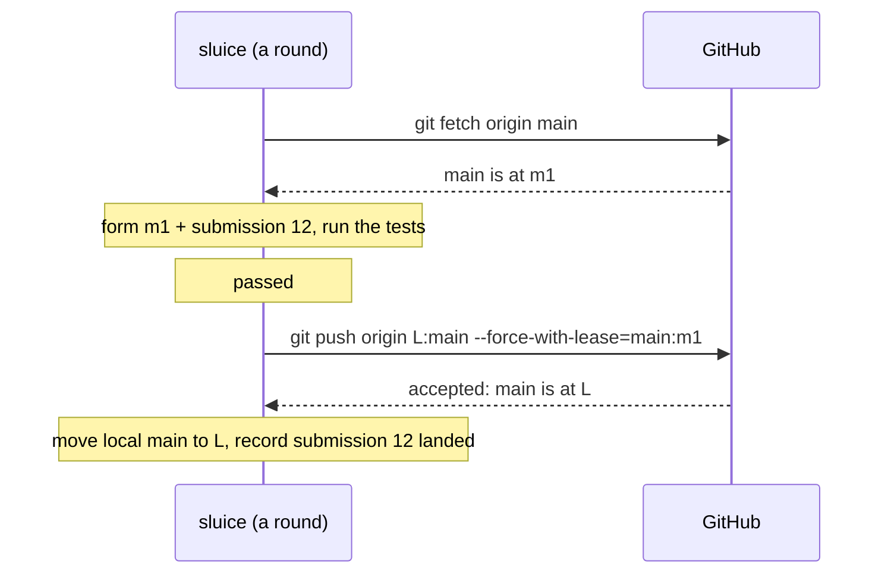

[Setting up sluice](/sluice/guides/walkthrough/) lands on a branch in
the repository on your machine. Most teams' `main` lives on GitHub
instead, and everyone pulls it from there. This guide makes sluice land
on GitHub's `main`, still running everything on your one machine.

## What changes

One line in the branch's policy, `.config/sluice.toml`:

```toml
[branches.main]
remote = "origin"
required = ["#check-fast", "#check-tools"]
```

sluice reads the policy from `main` as it stands before a landing, so
the landing that adds `remote` lands on your machine only. Push `main`
to GitHub by hand that once; sluice pushes every landing after it.

If GitHub's `main` is still older than what landed on your machine when
the next round reads it, sluice doesn't build on it: that would drop
the landings GitHub lacks. It holds `main` instead. Nothing is tested
or landed, and `sluice step`, `sluice status main` and a waiting submit
say so, naming GitHub's revision and the landing it lacks:

```console
$ sluice step main
held: main reads 10e4791, which lacks the landing c43609b; put the landing back on main, or run sluice branch accept main 10e4791
```

There are two ways out. Push your machine's `main` to GitHub, and the
next round lands the queue on it. Or, if GitHub's revision is the one
to keep, accept it with `sluice branch accept main 10e4791`, and the
queue is formed on it from then on.

With `remote` set, GitHub's copy of `main` is the real one:

- **Every round fetches it first.** Whoever runs the round (a waiting
  `wt submit`, `sluice run` or `sluice step`) fetches `main` from
  `origin` into `origin/main` before reading the branch, and forms every
  combination on it. Fetching leaves your local `main` where it is.
- **A landing is a push.** When a combination passes, sluice pushes its
  merge commit to GitHub's `main`, and the push only succeeds if `main`
  is still where the combination started. Then it moves your local
  `main` to match.
- **Only the branch goes to GitHub.** The queue, the test results and
  the logs stay in `.git/sluice/` on your machine, as before. On one
  machine nothing else needs them.

Nothing is rebased. A landing is the same merge commit as before, with
the submission's commits as its second parent and the result in its
trailers.



`sluice submit` and `wt submit` report "landed" only once GitHub has
accepted the push.

## Set up GitHub

Keep everyone else's pushes off `main` with a ruleset, in the
repository's **Settings › Rules › Rulesets › New branch ruleset**:

| setting | value |
|---|---|
| target branches | `main` |
| restrict updates | on |
| block force pushes | on |
| bypass list | sluice's GitHub App alone |

Leave GitHub's own merge queue off, and don't require status checks on
`main`: sluice's gate is the check, and it runs before the push.

sluice pushes as its own GitHub App, which [Give sluice its own GitHub
identity](/sluice/guides/github-app/) sets up. Only sluice's own fetches
and pushes carry the app's token, so the ruleset refuses every other
push to `main`, your agents' included. Until the app is set up, sluice
pushes with the credentials your `git push` uses, the bypass list has
to hold your account, and `sluice status` says sluice has no identity of
its own. Your agents push with those credentials too, so keeping them
off `main` is then the job of the `reference-transaction` hook that
`sluice protect` installs, as in [branch
protection](/sluice/guides/walkthrough/#4-branch-protection).

A worktree with `main` checked out falls behind GitHub's `main` on every
host that didn't land, and sluice moves `main` under it on the host that
did. Keep a detached worktree at `origin/main` instead, as [worktrees
beside sluice](/sluice/guides/worktrees/) shows.

## Bolts on GitHub

A bolt is a branch sluice lands on like `main`. Give its pattern a
`remote` to keep it on GitHub too, so agents on any host can work on one:

```toml
[branches."bolt/*"]
required = ["#check-fast"]
remote = "origin"
```

sluice makes the bolt there, at `main`'s revision on GitHub, and deletes
it once it has landed on `main`:

```console
$ sluice branch create bolt/payments --from main
created bolt/payments at 6ac0084c…, main's revision
$ sluice branch delete bolt/payments --into main
deleted bolt/payments, which was at 9f2e1d0a…, landed into main
```

Cut agents' worktrees from `origin/bolt/payments`. A host that has only
fetched the bolt, with no local branch of it, submits to it all the same.
A submission to a bolt GitHub doesn't have is refused, and the refusal
says to make it with `sluice branch create`.

Protect bolts as `main` is: one ruleset on `bolt/*` restricting
creations, updates, deletions and force pushes, with sluice's app as
its only bypass. `sluice forge check bolt/payments` checks it.

Each host keeps its own queue for a bolt. The lease keeps every landing
safe, but two hosts landing on one bolt land in the order their pushes
reach GitHub, and `sluice branch delete` sees only this host's queue.

## When `main` moves under the queue

While the bypass is yours, before sluice has its app, your own push to
`main` still gets through, and so does a click of GitHub's merge
button. sluice treats either as
`main` moving under its queue. Say someone pushes `4847258` to `main`
while submission 1's push is on its way:

```console
$ wt submit main
submission 1 to main · nothing queued ahead
testing main + #1 · 1 tasks to run, 0 replayed
passed · landed as f2a1614
```

The push names the revision the combination started from, so GitHub
refuses it once `main` has moved. sluice records the refusal in the
branch's log, lands nothing, and the next round forms every combination
again on the new `main` and tests it again. Nothing in the queue is
lost: `f2a1614` is the combination tested on `4847258`. The log says
what happened:

```console
$ grep refused .git/sluice/main/log.jsonl
{"schema":"sluice/log@1","at":"2026-10-14T20:02:23Z","event":"refused","ids":[1],"expected":"7c829a5…","found":"4847258…"}
```

The same holds when the push fails for any other reason, a dropped
connection included: the next round fetches and finds out where `main`
is. If sluice stops between the push and recording it, it
fetches on restart, finds its landing on `main`, and records it. Your
local `main` catches up at the next landing.

When sluice lands submissions exactly as they were tested, the ones behind
them keep their results and aren't tested again. Only a move from
outside the queue sends them back.

## When GitHub can't be reached

A round that can't fetch lands nothing, since it can't know where
`main` is. It stops and says why:

```console
$ wt submit main
sluice: fetching main from origin failed: ssh: Could not resolve hostname github.com: nodename nor servname provided, or not known
fatal: Could not read from remote repository.

Please make sure you have the correct access rights
and the repository exists.
```

Run it again once GitHub answers. Tests already running keep running,
and their results count when the next round reads them.

## What everyone else does

Pull `main` as usual: `git pull` brings in each landing, one merge
commit per submission. To land work, submit it to sluice; the ruleset
refuses a direct push to `main` from anyone but the bypass.

Next: [pull requests](/sluice/guides/pull-requests/), so
each submission has a page on GitHub and people can review it first.
