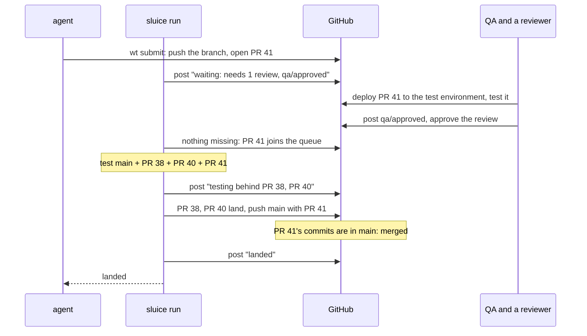

This builds on [GitHub integration](/sluice/guides/github/) and on
[protecting `main` on GitHub](/sluice/guides/github-app/): sluice reads
pull requests and posts on them as its GitHub App.
There, work went straight from an agent's worktree into sluice's queue.
Here, every piece of work also gets a pull request: a page where people
review it, where other systems post their checks, and where sluice shows
what it is doing with it.

None of this needs GitHub Actions. sluice still runs the tests on your
machine. Your repository's own CI can keep running on pull requests as
it does now.

## Two stages: waiting, then the queue

A pull request **waits** while it is a draft, or while something your
policy asks for is missing: an approving review, or a check another
system posts, such as your QA team's `qa/approved`. When it is out of
draft and nothing is missing, it **joins the queue**. sluice tests it
combined with everything ahead of it and lands it the moment that
passes.


A pull request never waits inside the queue. The queue lands in order,
so one held there for a day of QA would hold up everything behind it.
Everything in the queue is ready to land as soon as it passes.

## The policy

```toml
[branches.main]
remote = "origin"
required = ["#check-fast", "#check-tools"]

[branches.main.pull_requests]
reviews = 1                  # approving reviews on the current head
checks = ["qa/approved"]     # checks other systems post, by name
log_lines = 40               # post the end of a failed test's output
```

`required` is what sluice tests. `reviews` and `checks` are what a pull
request needs before sluice takes it. A name in `checks` is the name
GitHub shows for the check on the pull request, whoever posts it: your
CI, a deployment, a QA tool.

`log_lines` posts the last lines of a failed test's output in the pull
request's report, with anything shaped like a token or a key replaced by
`[redacted]`. Leave it out and the report says where the output is kept
on the host instead. Anyone who can read the repository reads the pull
request, and scrubbing catches the common shapes of a secret, not every
one, so turn it on only where the tests' output is safe to show.

With no `[branches.main.pull_requests]` table, there are no pull
requests and work goes straight into the queue, as in the previous
guide.

## Keep sluice running

An agent's waiting `wt submit` runs sluice's rounds, but a pull request
opened by hand has nobody waiting on it. Something has to notice it, so
keep a `sluice run` going while you work:

```sh
sluice run
```

Each round fetches `main`, asks GitHub for the open pull requests into
`main`, posts their states, and moves the queue. sluice starts no
service of its own, so how `sluice run` stays up (a terminal, a login
item, a service manager) is your choice.

## An agent submits

```console
$ wt submit main
pushed unit/batch-review · opened #41: Batch review cards
waiting: needs 1 review, qa/approved
  forecast: merges without conflict behind #38, #40
```

The agent's branch is pushed, and the pull request is opened with the
branch's commit messages. Submitting again from the same worktree
updates the same pull request.

A waiting `wt submit` reports each state as it changes and returns when
the pull request lands or is sent back. Waiting can take a day when
people review, so an agent that shouldn't wait submits with
`--no-wait`, and `wt submit --status` reads it later. `sluice wait main`
follows the pull request as a waiting submit does, and with `--timeout`
returns after that long, exiting `5` while it is still open.

## Several pull requests as one act

`sluice submit main` given several worktrees pushes each branch and
opens or updates each pull request, in the order given, as one act:

```console
$ sluice submit main --worktree ../bolt-a --worktree ../bolt-b --no-wait
pushed bolt/a · opened #51: Runner credentials
pushed bolt/b · opened #52: Runner cache
#51 waiting: needs 1 review
#52 waiting: needs 1 review
```

When sluice refuses one of the worktrees, one holding changes beyond its
commits, it refuses the act, and pushes nothing for any of them.

Each pull request's description gets a mark beside the one naming its
agent. The mark says it is one of the group, with its place in the
group, the group's size, and the commit it was opened at:

```text
<!-- sluice: group=20261023T120000Z-4f0c2a1 1/2 head=4f0c2a1… -->
```

sluice takes a group's pull requests only all together, in one pass and
in the group's order. It takes them once every one is open, out of
draft, and meeting its conditions on the commit it was marked at. Until
then each waits for the rest. One that is ready says which of its group
it waits for, `waiting for its group: #52`, and one that is not says
what it lacks itself. So no round tests the first alone before the rest
are in.

Once taken, each is a pull request of its own in the queue, blamed, sent
back and landed alone. New commits on one take that one out of the
queue, and it waits for its own conditions again: the mark binds only
the commit it was made at.

A group waits as long as any of it does. To free the rest when one is
closed or will not be ready, submit them again, as a new group without
that one or one by one. A submit of one worktree writes its pull
request's description without the group's mark.

## A person opens one by hand

Open a pull request into `main` from any branch of the repository, as
you always have. The next round finds it and posts its state. A draft
waits; mark it ready for review when it is. Pull requests from forks
are never taken.

## What sluice posts

sluice posts three things on a pull request, all as its app:

- a check named `sluice` on its latest commit, saying where it stands;
- once its combination has a result, a report in its conversation, one
  comment edited as the result changes, and the same report as the
  `sluice` check's details;
- a check for each required test on each system, such as
  `sluice / app:test (linux-x64)`, or `sluice / app:test` when the
  policy names no systems.

It also comments once when it sends a pull request back. The `sluice`
check reads:

| the check reads | means |
|---|---|
| `waiting: a draft` | still a draft; sluice takes it once it is marked ready for review |
| `waiting: needs 1 review, qa/approved` | out of draft, and these are missing on its latest commit; the details add where it would land now: "merges without conflict behind #38, #40" or "conflicts with #40 in plan.py" |
| `queued behind #38, #40` | in the queue, behind the pull requests it names |
| `testing main + #38 + #40 + #41` | its combination is being tested |
| `failed: app:test` | its combination failed and it is to blame; the comment names the failed tests and where their logs are |
| `conflict: plan.py` | it no longer merges with what is ahead of it; the comment names the files and the pull requests |
| `landed as b7d2e94` | on `main`; GitHub marks the pull request merged |

While a pull request waits or is queued, the check shows as pending on
GitHub; while it is tested, in progress; failed and conflict fail it,
and landed passes it. sluice posts only when the state changes.

The forecast runs no tests. It only checks whether the pull request
would merge on top of `main` and the queue as they are now, so a
conflict shows up while people are still reviewing.

### The report

The report is read from sluice's own records, so it reads the same
whatever runs your tests:

```text
## sluice: failed on main, #41 is to blame

Tested `a1b2c3d` = main `9f8e7d6` + #38 + #40 + #41 · 3 ran, 5 replayed

Total time: 4m 12s | Comparison time: 9m 40s | Estimated savings: 5m 28s (56% faster)

|    | Test         | Time  | Result        | Info                              |
|----|--------------|-------|---------------|-----------------------------------|
| 🟥 | `app:test`   | 2m 3s | Failed        | sandbox on box-1 · 2 attempts     |
| 🟨 | `app:e2e`    | 51s   | Flaky         | passed on the same inputs at …    |
| ⬛ | `site:check` |       | Could not run | the host failed [tests] ready …   |
| 🟩 | `app:lint`   | 18s   | Passed        | sandbox on box-1                  |
| 🟪 | `core:test`  |       | Replayed      | from a pass the gate trusts       |
```

- **The head line and the combination.** The first lines say where the
  pull request stands, and which pull requests were tested together, in
  the order they land.
- **One row per test on each system,** failed first. A row says whether
  the test ran, and where, or was replayed from a pass the branch
  trusts. It also says how long it took, how many times your task
  runner tried it, whether it is flaky, and why it could not run.
- **The runner's own figures.** The total time, the comparison time and
  the savings come from your task runner, moon today. They decide
  nothing: a test that passed on its second try is a pass, never flaky.
- **Long reports.** Past 20 rows the rest fold away, and collapsed
  sections list the executor, the changed files and, with `log_lines`,
  the failed tests' output.

While a combination is tested, the report shows each test as it starts
and ends. An ended test shows no result until the combination's results
are read.

A pull request tested together with one that is blamed sees none of
that failure. Its checks go back to queued, and its report says its
combination is formed again. Only the blamed pull request is told.

## The QA example, start to finish



## When things change

- **New commits on a pull request.** It leaves the queue and waits
  again. GitHub drops the old review if your repository dismisses stale
  reviews, and QA tests the new commits. sluice forms the combinations
  behind it again without it.
- **Sent back as the blamed submission, or for a conflict.** It stays open with
  the comment saying why. Push a fix and it waits for its conditions
  again. To retry the same commits, mark it a draft and then ready
  again.
- **Back to draft, or closed.** It leaves the queue.
- **One of a group closed before the group is taken.** The rest wait,
  and say they wait for it, until a submit names them again.
- **Merged with GitHub's button.** Don't, on a branch sluice keeps: with
  the ruleset from the previous guide only the bypass can, and sluice
  treats it as `main` moving under its queue, retesting everything
  queued.

## GitHub settings

Keep the ruleset from [the previous guide](/sluice/guides/github/). On
top of it:

- Give sluice's app Checks and Pull requests, read and write, beside
  Contents: it posts its check and its comments, and opens pull
  requests, with them.
- Leave GitHub's merge queue off; sluice is the queue.
- Don't require approvals or status checks in the ruleset, sluice's own
  checks included. Put approvals and other systems' checks in
  `[branches.main.pull_requests]` instead, so they are read from `main`
  itself and a pull request can't loosen them. sluice's checks show
  where a pull request stands; what lands is decided by the tests sluice
  runs.
- Turn on "dismiss stale pull request approvals" if new commits should
  need a new review.

## GitHub Actions as sluice's executor

This guide runs sluice's tests on your machine. Running them, and
sluice's rounds, as GitHub Actions jobs is [designed, not
built](/sluice/roadmap/). It will use pull requests exactly as this
guide does, and change only where the work runs.
