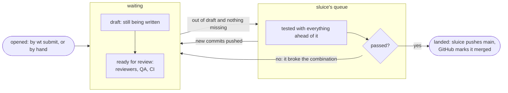
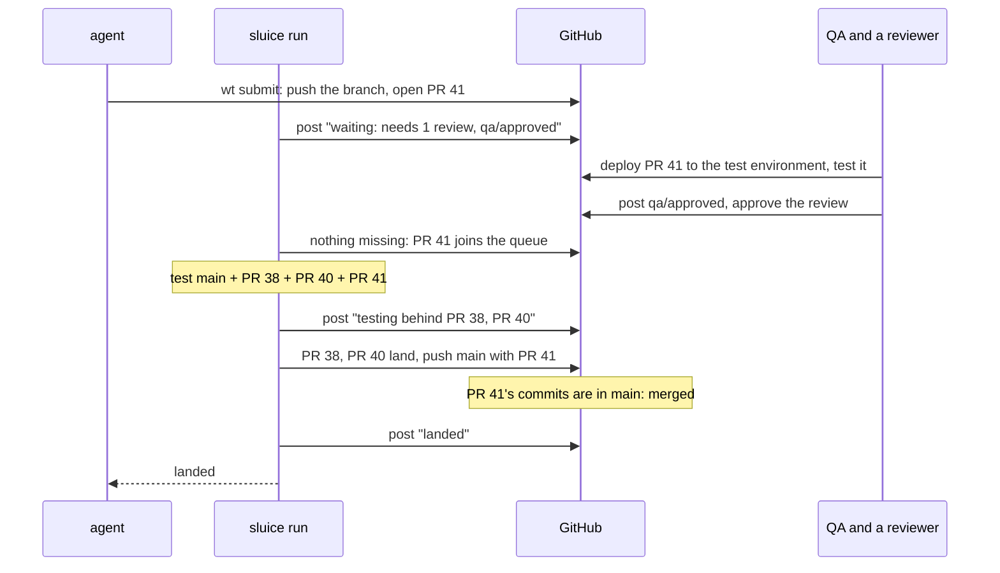

This builds on [GitHub integration](/sluice/guides/github/) and on
[protecting `main` on GitHub](/sluice/guides/github-app/): sluice reads
pull requests and posts on them as its GitHub App.
There, work went straight from an agent's worktree into sluice's queue.
Here, every piece of work also gets a pull request: a page where people
review it, where other systems post their checks, and where sluice shows
what it is doing with it.

None of this needs GitHub Actions. sluice still runs the tests on your
machine. Your repository's own CI can keep running on pull requests as
it does now.

## Two stages: waiting, then the queue

A pull request **waits** while it is a draft, or while something your
policy asks for is missing: an approving review, or a check another
system posts, such as your QA team's `qa/approved`. When it is out of
draft and nothing is missing, it **joins the queue**. sluice tests it
combined with everything ahead of it and lands it the moment that
passes.



A pull request never waits inside the queue. The queue lands in order,
so one held there for a day of QA would hold up everything behind it.
Everything in the queue is ready to land as soon as it passes.

## The policy

```toml
[branches.main]
remote = "origin"
required = ["#check-fast", "#check-tools"]

[branches.main.pull_requests]
reviews = 1                  # approving reviews on the current head
checks = ["qa/approved"]     # checks other systems post, by name
```

`required` is what sluice tests. `reviews` and `checks` are what a pull
request needs before sluice takes it. A name in `checks` is the name
GitHub shows for the check on the pull request, whoever posts it: your
CI, a deployment, a QA tool.

With no `[branches.main.pull_requests]` table, there are no pull
requests and work goes straight into the queue, as in the previous
guide.

## Keep sluice running

An agent's waiting `wt submit` runs sluice's rounds, but a pull request
opened by hand has nobody waiting on it. Something has to notice it, so
keep a `sluice run` going while you work:

```sh
sluice run
```

Each round fetches `main`, asks GitHub for the open pull requests into
`main`, posts their states, and moves the queue. sluice starts no
service of its own, so how `sluice run` stays up (a terminal, a login
item, a service manager) is your choice.

## An agent submits

```console
$ wt submit main
pushed unit/batch-review · opened #41: Batch review cards
waiting: needs 1 review, qa/approved
  forecast: merges without conflict behind #38, #40
```

The agent's branch is pushed, and the pull request is opened with the
branch's commit messages. Submitting again from the same worktree
updates the same pull request.

A waiting `wt submit` reports each state as it changes and returns when
the pull request lands or is sent back. Waiting can take a day when
people review, so an agent that shouldn't wait submits with
`--no-wait`, and `wt submit --status` reads it later.

## A person opens one by hand

Open a pull request into `main` from any branch of the repository, as
you always have. The next round finds it and posts its state. A draft
waits; mark it ready for review when it is. Pull requests from forks
are never taken.

## What sluice posts

sluice posts one check named `sluice` on the pull request's latest
commit, and comments when it sends one back:

| the check reads | means |
|---|---|
| `waiting: a draft` | still a draft; sluice takes it once it is marked ready for review |
| `waiting: needs 1 review, qa/approved` | out of draft, and these are missing on its latest commit; the details add where it would land now: "merges without conflict behind #38, #40" or "conflicts with #40 in plan.py" |
| `queued behind #38, #40` | in the queue, behind the pull requests it names |
| `testing main + #38 + #40 + #41` | its combination is being tested |
| `failed: app:test` | its combination failed and it is to blame; the comment names the failed tests and where their logs are |
| `conflict: plan.py` | it no longer merges with what is ahead of it; the comment names the files and the pull requests |
| `landed as b7d2e94` | on `main`; GitHub marks the pull request merged |

While a pull request waits or is queued, the check shows as pending on
GitHub; while it is tested, in progress; failed and conflict fail it,
and landed passes it. sluice posts only when the state changes.

The forecast runs no tests. It only checks whether the pull request
would merge on top of `main` and the queue as they are now, so a
conflict shows up while people are still reviewing.

## The QA example, start to finish



## When things change

- **New commits on a pull request.** It leaves the queue and waits
  again. GitHub drops the old review if your repository dismisses stale
  reviews, and QA tests the new commits. sluice forms the combinations
  behind it again without it.
- **Sent back as the blamed submission, or for a conflict.** It stays open with
  the comment saying why. Push a fix and it waits for its conditions
  again. To retry the same commits, mark it a draft and then ready
  again.
- **Back to draft, or closed.** It leaves the queue.
- **Merged with GitHub's button.** Don't, on a branch sluice keeps: with
  the ruleset from the previous guide only the bypass can, and sluice
  treats it as `main` moving under its queue, retesting everything
  queued.

## GitHub settings

Keep the ruleset from [the previous guide](/sluice/guides/github/). On
top of it:

- Give sluice's app Checks and Pull requests, read and write, beside
  Contents: it posts its check and its comments, and opens pull
  requests, with them.
- Leave GitHub's merge queue off; sluice is the queue.
- Don't require approvals or status checks in the ruleset. Put them in
  `[branches.main.pull_requests]` instead, so they are read from `main`
  itself and a pull request can't loosen them.
- Turn on "dismiss stale pull request approvals" if new commits should
  need a new review.

## GitHub Actions as sluice's executor

This guide runs sluice's tests on your machine. A separate design runs
them, and sluice's rounds, as GitHub Actions jobs instead, with the
queue kept in the repository: see
[GitHub Actions](/sluice/many-hosts/github-actions/). It uses pull
requests exactly as this guide does, and changes only where the work
runs.
